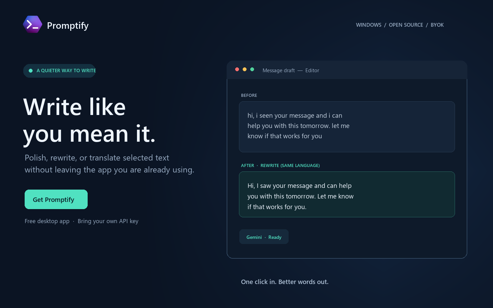
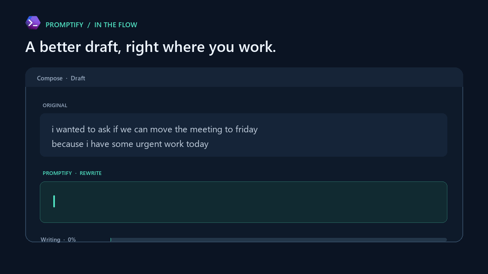

<div align="center">

# Promptify



### Better words, right where you work.
**A high-performance Windows writing assistant and voice dictation engine.**  
Instant rewrites, Roman Urdu polish, voice-to-text, and direct AI enhancement in any app.

<br>

[](https://github.com/mrhidden313/Promptify)
[](https://github.com/mrhidden313/Promptify/releases)
[](LICENSE)
[](https://github.com/mrhidden313/Promptify)

<br>

<!-- PRIMARY DOWNLOAD SECTION -->
<table>
  <tr>
    <td align="center" width="440" style="padding: 20px; border-radius: 12px; background-color: #0d1117;">
      <h3>⚡ Official Windows Installer</h3>
      <p>Full setup wizard • Start Menu & Desktop shortcuts • Automatic updates & clean uninstaller.</p>
      <a href="https://github.com/mrhidden313/Promptify/raw/refs/heads/main/downloads/Promptify_Setup_v1.0.exe?download=1">
        
      </a>
      <br><sub>Recommended for Windows 10 & 11 • Zero configuration needed</sub>
    </td>
    <td align="center" width="440" style="padding: 20px; border-radius: 12px; background-color: #0d1117;">
      <h3>📦 Portable Executable</h3>
      <p>Single standalone binary • No installation required • Runs directly from USB or folder.</p>
      <a href="https://github.com/mrhidden313/Promptify/raw/refs/heads/main/downloads/Promptify.exe?download=1">
        
      </a>
      <br><sub>Run immediately without installer wizard</sub>
    </td>
  </tr>
</table>

<br>



</div>

---

## ✨ Core Capabilities

- **🎙️ Voice Dictation Engine (`Ctrl+Shift+Space`)**: Speak in Roman Urdu or English and have your words transcribed and polished instantly into the active field.
- **⚡ In-Place Text Enhancement (`Ctrl+Alt+F`)**: Select any text in any editor (VS Code, Chrome, WhatsApp, Word), trigger Promptify, and receive a refined version in real-time.
- **🇵🇰 Roman Urdu to Fluent English & Polish**: Correct phonetic Roman Urdu spelling while keeping Latin characters, or translate directly into executive-level English.
- **🤖 Universal AI Provider Hub**: Connect with **Gemini**, **OpenAI**, **Groq**, **DeepSeek**, **xAI**, **OpenRouter**, or custom OpenAI-compatible endpoints with automatic failover fallback.
- **🔒 Zero-Cloud Security (DPAPI)**: API keys are stored locally with Windows Data Protection API (DPAPI) encryption. No third-party servers see your credentials.
- **⌨️ Word-by-Word Live Typing**: Fluid, human-like typing simulation into native fields, or one-click atomic clipboard paste.
- **🛑 Instant Cancellation**: Press `Ctrl+Win` to pause, or click Cancel to stop ongoing API streams without disrupting the active window.

---

## 🚀 Quick Start Guide

### 1. Download & Install
1. Download **[Promptify_Setup_v1.0.exe](https://github.com/mrhidden313/Promptify/raw/refs/heads/main/downloads/Promptify_Setup_v1.0.exe?download=1)**.
2. Run the installer wizard (`Next > Next > Finish`).
3. Promptify will launch and sit ready in your Windows System Tray and floating desktop hub.

### 2. Configure Your API Key
1. Click the floating Promptify icon or right-click the system tray icon to open **Settings**.
2. Select your preferred provider (e.g. Gemini, Groq, OpenAI).
3. Paste your API key. (Keys are encrypted locally and never transmitted elsewhere).

### 3. Hotkeys

| Shortcut | Action | Description |
| :--- | :--- | :--- |
| **`Ctrl + Alt + F`** | **Enhance / Rewrite** | Rewrites currently selected text in-place |
| **`Ctrl + Shift + Space`** | **Voice Dictation** | Records speech and streams polished transcription |
| **`Ctrl + Win`** | **Quick Toggle** | Instantly enable / disable AI prompts |

---

## 🛠️ Supported AI Providers

| Provider | Recommended Model | Key Portal |
| :--- | :--- | :--- |
| **Google Gemini** | `gemini-2.5-flash-lite` | [Google AI Studio](https://aistudio.google.com/apikey) |
| **Groq (Ultra-Fast)** | `llama-3.3-70b-versatile` | [Groq Console](https://console.groq.com/keys) |
| **OpenAI** | `gpt-4o-mini` | [OpenAI Platform](https://platform.openai.com/api-keys) |
| **DeepSeek** | `deepseek-chat` | [DeepSeek Platform](https://platform.deepseek.com/api_keys) |
| **xAI** | `grok-3-mini` | [xAI Console](https://console.x.ai/) |
| **OpenRouter / Custom** | Bring your own model ID | [OpenRouter Keys](https://openrouter.ai/keys) |

---

## 💻 Building from Source

Requires **Windows 10/11** and **Python 3.12+**:

```powershell
# 1. Clone repository
git clone https://github.com/mrhidden313/Promptify.git
cd Promptify

# 2. Install dependencies
python -m pip install -r requirements.txt

# 3. Launch application
python main.py
```

### Building the Standalone `.exe` & Installer

```powershell
# Build portable executable (PyInstaller)
.\build_release.ps1

# Build Windows Setup Installer (Inno Setup)
# Open Promptify_Installer.iss in Inno Setup Compiler and click 'Run' (F9)
```

---

## 👤 Author

Built by **[Mr Farman](https://fktech.site)**  
GitHub: [@mrhidden313](https://github.com/mrhidden313)

---

## 📄 License

Promptify is open-source software licensed under the [MIT License](LICENSE).
